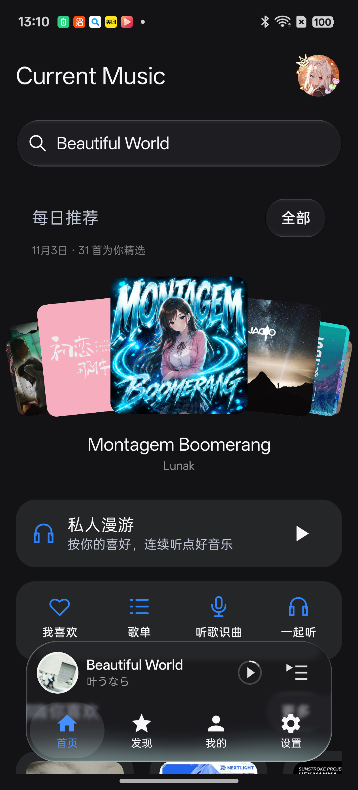
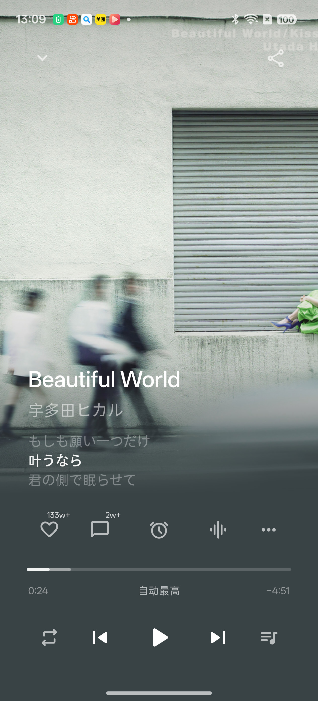
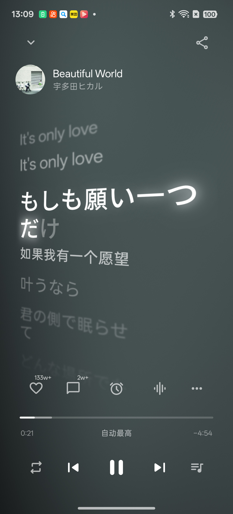
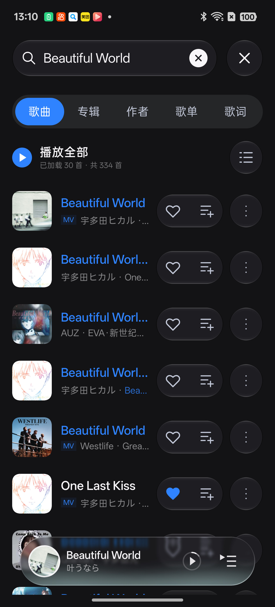
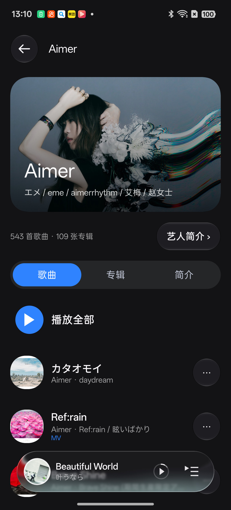
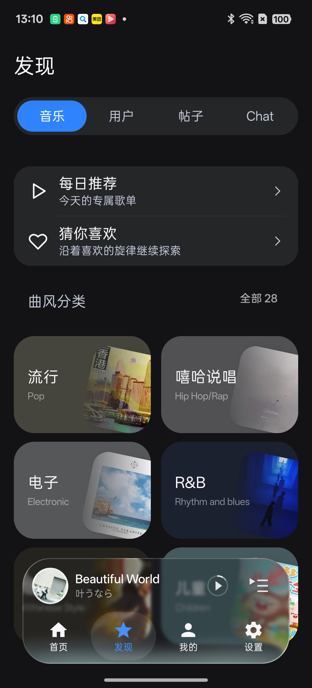
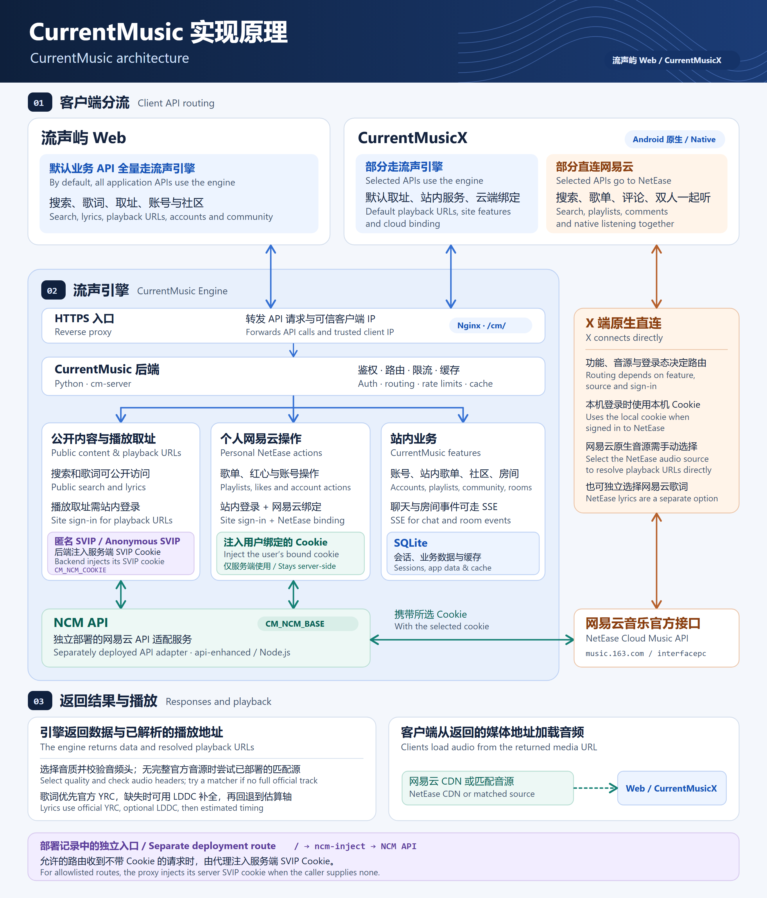

<div align="center">


# CurrentMusicX

[简体中文](README.md) · **English**

**Artwork and lyrics that move with the music**

NetEase Cloud Music · Self-hosted Navidrome / Emby libraries · Two-person listening

Native Android client built with Kotlin, Jetpack Compose, and Miuix

<p>
  <a href="https://github.com/bileizhen/CurrentMusicX/releases/latest"></a>
  <a href="#compatibility"></a>
  <a href="#license-and-credits"></a>
</p>

**[Download the app](https://github.com/bileizhen/CurrentMusicX/releases/latest)** · [Getting started](#getting-started) · [Release notes](https://github.com/bileizhen/CurrentMusicX/releases) · [Report an issue](https://github.com/bileizhen/CurrentMusicX/issues)

</div>

CurrentMusicX is the native Android client for [CurrentMusic](https://github.com/backrooms-yrc/CurrentMusic). Circular artwork, dynamic colors, word-by-word lyrics, and a floating player connect your library, discovery, and playback across portrait, landscape, and wide layouts.

## Screenshots

<p align="center">
  
  
</p>

<p align="center"><sub>Captured on an RMX5060 running release 1.3.1 on 2026-11-03. The interface may vary by installed version. Click an image for the full size.</sub></p>

<details>
<summary>More screens: lyrics, search, artist page, and discovery</summary>

<p align="center">
  
  
</p>
<p align="center">
  
  
</p>

</details>

## Getting started

1. **Install the app.** Download `CurrentMusic-Android-v<version>.apk` from [Releases](https://github.com/bileizhen/CurrentMusicX/releases/latest) and follow Android's installation prompt. Official builds with the same signature can upgrade an existing installation.
2. **Choose your sources.** In **Settings → Sources & Network**, choose audio and lyric sources separately. Automatic lyric selection is the default and prefers word-by-word timing, with line-by-line lyrics as a fallback.
3. **Connect your library.** Sign in to CurrentMusic, link NetEase, or connect Navidrome or Emby under **Settings → Sources & Network → Self-hosted libraries**. Connected libraries appear under **Me → Music services** and hide after sign-out.

Track, quality, member effects, and recommendation availability depend on the service and account entitlements. This page describes the current `main` source. See [GitHub Releases](https://github.com/bileizhen/CurrentMusicX/releases) for changes and verification scope by release.

[Features](#features) · [Audio and lyrics](#audio-and-lyrics) · [Architecture](#architecture) · [Compatibility](#compatibility) · [FAQ](#faq) · [Build and test](#build-from-source-and-test-on-a-device) · [Contributing](#issues-pull-requests-and-releases)

## Features

### Playback

- **Player controls.** Background playback, notification, lock screen, and Bluetooth controls. Use a queue, repeat, shuffle, Heartbeat mode, a sleep timer, and music videos.
- **Lyrics and effects.** Automatic matching across six sources, word-by-word highlighting, translations, and romanization. Choose Monet animation, flowing smoke, stardust, or perspective effects. Apply per-track offsets, import several formats, and export FIA or LRC.
- **Audio effects and transitions.** Local EQ, original standard and smart effects, AI Mood Tuner, AI Tuning Master, and speaker presets. Choose smart transitions or fades.
- **Downloads and sharing.** Select quality and destination, track background progress, cancel, or retry. Downloads can include tags, artwork, and lyrics. Generate posters, playback links, and QR codes.
- **Quality tiers.** Hi-Res (`hires`), HD Premium (`jyeffect`), and Premium Spatial (`vivid`) have separate labels. Higher Quality and Dolby Atmos are also selectable. The tier is a request to the source. Actual files and device output depend on the source, track, and account entitlements.

### Your library and shared listening

- **Libraries.** Manage NetEase likes and playlists, create CurrentMusic playlists, and browse Navidrome or Emby albums and artists. Search, favorite, and play at original quality.
- **Local audio.** Under **Local Music → Scan scope → Choose folder**, scan the selected directory and its subdirectories. The app remembers the location and asks again if access expires. A device-wide scan requires explicit selection and audio permission. Changing scan scope preserves the active queue.
- **Discovery.** Search by category or lyrics, browse suggestions, daily recommendations, trends, and genres. Personal FM supports default, familiar, exploration, mix, and dynamic scenes. Your previous queue can be restored after a session.
- **Two-person listening.** Use native NetEase invites and short links, a shared queue, synchronized track changes, and reconnection. Browse history, rankings, session recaps, and compatibility reports.
- **Accounts and community.** Multiple accounts, profiles, password changes and email recovery, listening stats, announcements, posts, public chat, and AI conversations. The optional NetEase task center and foreground check-ins are off by default.

### Appearance

Choose light, dark, or pure black themes with Monet colors. Use circular or immersive artwork, custom player backgrounds, Liquid Glass, a floating navigation bar, and desktop lyrics. Preview changes live and adjust colors, fonts, text scaling, startup animation, and playlist style.

<details>
<summary>Appearance and interaction details</summary>

- **Themes and fonts.** Preview Home, Discover, Me, Settings, and the mini player. Pick colors from palettes, a grid, a spectrum, or HSV. Search system fonts or import TTF, OTF, and TTC files, which the app copies to local storage.
- **Glass.** Choose standard or liquid under **Settings → Appearance → Liquid Glass**. The liquid style draws on FlClash for transparency, refraction, and soft shadows. A separate blur control adjusts frosting. Android versions below 13 and surfaces that cannot sample the background use regular panels.
- **Startup animation.** Preview classic (default), halo, signature, or none. Signature draws the username offline, uses a welcome message for blank names, wraps and scales long names, and fades in unsupported glyphs. Disabling system animations skips to the end state.
- **Navigation.** A fixed fading header, floating bottom bar, rounded grouped settings, and container-transform back navigation. Chat supports multiline input, an add menu, failed draft recovery, and explicit retry. The bottom bar hides in Chat.
- **Landscape player.** Uses your artwork preference. Immersive artwork fills the page, with a dark gradient behind lyrics and controls on the right. Swipe horizontally to switch between lyrics and controls.
- **Playlist browsing.** Use Depth Ribbon or the CD shelf. The shelf can pick tracks at random, preview a chorus or full track, loop, and advance automatically. Undo a removed like.

</details>

<details>
<summary>Playback, lyrics, and audio effects</summary>

- Tapping a track in search inserts and plays that track while preserving the queue. Playlists and albums support full-list playback.
- Choose either smart transitions or fades for automatic track changes. Both start off. Fades range from 1 to 12 seconds. Playback alongside other apps has its own setting.
- Use **Player menu → Playback background** to choose a system image and preview 0–100% blur. The image stays on the device across restarts. You can restore the artwork-derived background.
- Enable **Me → NetEase account → NetEase tasks** to add a task shortcut. A local NetEase session is required. Automatic daily and Yunbei check-ins have a separate switch and run in the foreground. NetEase confirms progress and rewards based on actual listening records.
- The lyrics view prefers genuine word timings and filters server estimates. Set karaoke compatibility to **Always** to generate approximate highlighting for line-by-line lyrics on the device.
- Audio effects use native Compose and a bundled ARM64 engine. The server verifies member entitlements. The app identifies unavailable algorithms. Speaker presets apply for the current session.
- The in-app island shows temporary feedback for effects, downloads, and errors. Desktop lyrics require system overlay permission. The window stays locked. Settings control height, font size, and translation. Taps can toggle the view, and horizontal swipes change tracks.

</details>

<details>
<summary>Libraries, search, and shared listening</summary>

- First sign in to CurrentMusic, then use a QR code or SMS verification to sign in to NetEase. With a local NetEase session, search, playlists, likes, recommendations, and comments use direct NetEase requests. Some features can use an existing cloud binding when the local session is absent. The server keeps its copy of the credential.
- **Use NetEase as main library** changes the default library shortcut. **Settings → Playback → Default like destination** controls where likes go. Navidrome favorites go to the connected server.
- Search, sort, create, and manage playlists. The CD shelf can collapse search, pick tracks at random, preview a chorus or full track, loop, and advance. Undo a removed like from the island. CurrentMusic playlists can import NetEase Liked Songs. Switching libraries preserves existing playlists.
- Search offers collapsible history, two-column suggestions, and a horizontal NetEase trends list, including ACG and Japanese categories. Tap a suggestion to search. The **Lyrics** category returns tracks with matching lyric excerpts.
- The **Playlists** search category shows cover artwork, creators, and track counts, with pagination and retry. Playlist details use the existing view. Switching categories or navigating back preserves results and scroll position.
- Tapping NetEase links for songs, playlists, albums, artists, or MVs, `163cn.tv` short links, listen-together invites, or CurrentMusic site `/app/` links in chat or a browser opens them in the app: song links resolve and play the track, other links open the matching page, and invites only prefill until confirmed. CurrentMusic domains depend on site app-link verification; NetEase domains need to be allowed under the system default-open-links setting.
- Native NetEase listening shares the existing search and playback queue. It supports recommendations based on both listeners' tastes, removal, clearing, queue downloads, and likes. NetEase controls access to recommendations, history, rankings, and reports.
- On cold start, the app checks for an interrupted NetEase session and can restore it. Starting other playback cancels restoration. The recap appears after NetEase confirms the session ended. You can like songs and export a share poster.
- CurrentMusic rooms support passwords, song approval, and member permissions. Navidrome and Emby libraries are currently for playback on the device.

</details>

## Audio and lyrics

Set audio and lyric sources independently in **Settings → Sources & Network**. Changing the lyric source reloads the current track's lyrics and keeps caches separate by source.

### Audio sources

| Source | How it works |
| --- | --- |
| **CurrentMusic (default)** | Resolve playback through the configured CurrentMusic server using a CurrentMusic account. |
| Native NetEase | Connect directly with the local NetEase account's entitlements. This mode keeps playback resolution on the direct route. |
| LeiZ API | Configure an API key for this service. The app stores it encrypted on the device. |
| LX Music source | Import one or more `.js` files or links. With **Smart source switching** enabled, the app prefers the script that resolves fastest and falls back to other imported sources on failure. It resolves tracks with a valid NetEase ID. Search and playlists keep their original sources. |

LX Music scripts send track information to their service. Import scripts from sources you trust. Smart-switch retries send the same track information to other imported scripts' services. Connect Navidrome under **Settings → Sources & Network → Self-hosted libraries** to play audio directly from your server.

Connect Emby under **Settings → Sources & Network → Self-hosted libraries → Emby**. The library appears under **Me → Music services**. It opens on Songs, with the bottom bar switching between Songs, Artists, Playlists, and Favorites. Albums are available from the artist page. Search and refresh sit together at the top. Enter the server URL, which can include a reverse proxy subpath, and your username and password. The app stores the encrypted token after sign-in. Albums, songs, artists, playlists, and favorites load 40 items at a time. The library supports track search, server favorites, queue playback, original-quality caching, and preloading. Playlists are read-only, and downloads follow server permissions. Emby playback currently uses the original stream on the device. Lyrics use the app's automatic matching, manual matching, and local imports.

### How lyrics are selected

- **Automatic (default).** Search QQ Music, NetEase, AMLL, Kugou, Qishui, then CurrentMusic. Candidates must match track metadata at 75% or higher. Use the first genuine word-timed result, or retain the first usable line-timed result.
- **Specific source.** Choose CurrentMusic with server-side LDDC data, direct NetEase YRC / LRC, or embedded lyrics.
- **Per track.** Search, preview, save, or import from **Player → Manage lyrics**. Manually saved or imported lyrics and embedded lyrics take priority over automatic matching.

**To use direct NetEase for both audio and lyrics, select Native NetEase audio and NetEase lyrics.** The local NetEase library and native two-person listening also connect to NetEase directly.

<details>
<summary>Lyric matching, offsets, imports, and exports</summary>

- Import LRC, TTML, FIA, VTT, YRC, plain-text QRC, or KRC.
- Folia's metadata scoring assigns 45 points to the title, 25 to the artist, and 30 to the album, with a penalty for duration differences. Each source picks a reliable candidate from its top ten results. Automatic selection uses a 75-point threshold and scores track metadata.
- AMLL uses the matched NetEase track ID and can work without baseline NetEase lyrics. Slow sources time out. Manual preview retains adaptive alignment.
- The original word timings are preserved. The player, mini player, and desktop lyrics share display alignment. A positive per-track offset delays lyrics. A negative offset advances them. Apply it over existing alignment or reset it independently.
- FIA and LRC exports preserve original timings. FIA also stores and restores adaptive alignment.

</details>

<details>
<summary>CurrentMusic servers and update downloads</summary>

Under **Settings → Sources & Network → CurrentMusic server**, the list shows Auto, `music.20110208.xyz`, `cm.bileizhen.top`, `currentmusic.geekertao.com`, `music.ctcehs.com`, and Custom in a fixed order with announcement endpoint latency. New installs start with Auto, which probes presets at startup and selects a faster available route. You can probe again manually. Existing selections are retained. Switching between the primary host and CDNs preserves sign-in. Custom addresses are saved independently. Switching to a separate server requires signing in again. The full API path is `/cm/`. The CurrentMusic update mirror follows the selected built-in CDN. Probes and downloads use the same route, and the app verifies package size and SHA-256 against GitHub release information.

The address applies to CurrentMusic accounts, audio and lyrics, cloud bindings, profiles, the community, and rooms. Native NetEase, LeiZ, other audio and lyric providers, and self-hosted libraries use their respective addresses.

</details>

## Architecture

[](.github/img/architecture.png)

### How the clients route requests

- **CurrentMusic Web** sends application API requests for search, track details, lyrics, playback URLs, accounts, and community features to the engine at `/cm/` by default. Selecting LeiZ sends playback URL requests directly to LeiZ. The cloud upload flow obtains a token and registers the file through the engine, while the browser can send the file itself directly to object storage.
- **CurrentMusicX** routes each request by feature, audio source, and sign-in state. Playback URL resolution with the default source, CurrentMusic accounts and playlists, the community, CurrentMusic rooms, and cloud account linking go through the engine. Search, comments, and NetEase's native two-person listening can go directly to NetEase. With a local NetEase session, personal playlists, likes, and recommendations generally go directly as well. With no local session, selected account features can use the engine's saved NetEase binding. Selecting the native NetEase audio source makes the phone resolve playback URLs directly. Lyrics have their own source setting.

### How the engine handles requests

1. An HTTPS reverse proxy forwards `/cm/` to the Python backend and supplies a trusted client IP. The backend applies route-specific authentication, rate limits, and caching. Guests can request public search results, track details, and lyrics. Media URL resolution requires a CurrentMusic account. Search and playback URL requests can pass the trusted IP upstream and partition the cache by IP.
2. The backend handles CurrentMusic accounts, playlists, community features, and rooms. SQLite stores sessions and application data. Chat and listening rooms can receive updates over Server-Sent Events (SSE). For NetEase operations, the backend calls the separately deployed NCM API at `CM_NCM_BASE`. This Node.js service (api-enhanced) makes the NetEase protocol request and returns the result.
3. Personal NetEase actions use a separate authentication path. The engine checks the CurrentMusic session and retrieves that user's linked NetEase cookie to access playlists, likes, and other account data. After local NetEase sign-in, X can sync the credential through `/cm/ncmbind/import`, where the server verifies the account before storing it. The engine uses its stored cookies server-side.

### How Anonymous SVIP resolves a playback URL

1. A signed-in **CurrentMusic** user sends their site token, track ID, and requested quality to `GET /cm/ncm/song/url`. “Anonymous” refers to playback URL resolution without a personal NetEase account binding.
2. The backend reads the server's NetEase SVIP cookie from the file configured by `CM_NCM_COOKIE` and injects it into the official `/song/url/v1` request to the NCM API. NetEase responds according to the server account's entitlements, track restrictions, and requested quality. The site token authenticates the user to the engine. The server cookie authenticates the upstream request.
3. The engine selects an available quality and probes the audio header at the resulting official URL. If official resolution fails or yields a preview, a deployed matcher can look up alternate sources and validate the audio and duration. The matcher uses public track metadata and receives neither NetEase cookie.
4. The backend returns the playback URL and verifiable audio properties. For normal playback, Web and X read the audio directly from the returned CDN or matched-source URL. Lyrics have a separate endpoint. The engine prefers official YRC, can use LDDC for missing word timings, and falls back to LRC with estimated timings marked. X can independently select direct NetEase lyrics or automatic matching across sources.

The deployment notes also describe a separate `ncm-inject` entry point. It adds the server SVIP cookie to allowlisted requests that arrive without a caller cookie, then passes them to the NCM API. The default client routes in the diagram use `/cm/`.

[X request routing](app/src/main/java/io/github/currencortex/music/core/network/ApiClient.kt) · [Engine backend](https://github.com/backrooms-yrc/CurrentMusic/tree/main/backend) · [Playback URL resolution](https://github.com/backrooms-yrc/CurrentMusic/blob/main/docs/playback-sources.md) · [Account linking](https://github.com/backrooms-yrc/CurrentMusic/blob/main/docs/third-party-ncm-sync.md) · [Deployment notes](https://github.com/backrooms-yrc/CurrentMusic/blob/main/docs/api-5-phase-plan.md#1-实测拓扑)

## Compatibility

| Item | Requirement |
| --- | --- |
| Android | Android 8.0 / API 26 or later. Target Android 16 / API 36. |
| Architecture | Official APK targets ARM64 (arm64-v8a) with the adapted original audio effects engine. |
| Layout | Portrait, landscape, and wide navigation. |
| Dynamic colors | Monet requires Android 12 / API 31 or later. |
| Real-time blur | Android 13 / API 33 or later. Older versions or disabled blur use a regular surface. |
| Download directory | System folder picker / SAF. On Android 10 or later, the default is `Download/CurrentMusic`. |

Some vendor native libraries still fall short of the 16 KiB page-size requirement. Compatibility with those devices remains unverified.

## FAQ

<details>
<summary>Where are downloaded tracks, artwork, and lyrics stored?</summary>

Choose a directory and grant the app access when downloading. The app writes tags, artwork, and lyrics into the audio file and saves companion LRC and artwork files. Supported formats include MP3, FLAC, M4A, Vorbis OGG, and WAV. Raw AAC is wrapped in M4A without re-encoding. Embedded lyrics and word-by-word rendering depend on the other player's format support.

</details>

<details>
<summary>How do updates work? Can a custom build upgrade the official app?</summary>

Use **Settings → Check for updates** to view new versions, configure startup checks, and select an update channel and source. The startup prompt lets you dismiss an update or view details. The mirror list shows status and latency, with the dedicated mirror first and other available mirrors ordered by latency. Background downloads support cancellation, retry, and switching mirrors. If a mirror fails or the size or SHA-256 differs, the app tries an alternate mirror. Android prompts for installation after package and signature checks. A first installation may require permission to install apps from that source.

An in-place upgrade requires the same signing key as the installed app. Use the [isolated test build](#build-from-source-and-test-on-a-device) for development and device testing.

</details>

<details>
<summary>How do I report a problem?</summary>

Include the app version, device model, Android version, steps to reproduce, and what happened. Export diagnostic logs from Settings and redact personal information before sharing. [Issues](https://github.com/bileizhen/CurrentMusicX/issues)

</details>

## Privacy and development

Local account credentials are encrypted. The app connects to NetEase, CurrentMusic, Navidrome, or Emby as needed, loads audio, videos, and images from returned URLs, and saves downloads in the directory you choose. [Privacy notice](PRIVACY.md)

Issues and pull requests are welcome. Describe the problem and what you verified. Keep each contribution focused on one feature or fix.

## Build from source and test on a device

Use JDK 17 or later, Android SDK Platform 37.0, and Build Tools 35.0.0. Set the SDK path with `ANDROID_HOME` or `sdk.dir` in local `local.properties`.

On Windows, run the following in PowerShell.

```powershell
.\gradlew.bat :app:assembleDebug :app:testDebugUnitTest :app:lintDebug
```

On Linux or macOS, run the same tasks with `./gradlew`. The debug APK is at `app/build/outputs/apk/debug/app-debug.apk`.

With a device connected, use the isolated debug package to keep test data separate.

```powershell
.\gradlew.bat -PisolatedDebug=true :app:assembleDebug :app:connectedDebugAndroidTest
```

The isolated application ID is `com.bileizhen.currentmusic.verification`. Device tests may require a sign-in, network access, Android permissions, or specific test material. Build and unit tests cover local checks. Device testing covers the live APIs and UI.

Use `:app:assembleRelease` for a release build. Signing reads `storeFile`, `storePassword`, `keyAlias`, and `keyPassword` from local `keystore.properties`. With no signing configuration, the APK is unsigned. Keep keys, account settings, and verification output out of the repository.

<details>
<summary>Release size, Baseline Profile, and performance checks</summary>

Release builds enable R8 and resource shrinking. The universal APK includes existing ABIs and preserves the original NetEase audio effects, MNN, and JNI names. Generate a size report with `python scripts/apk_size_report.py app/build/outputs/apk/release/app-release.apk --json output/apk-size.json`. It reports ZIP size, unpacked size by ABI, and ELF page alignment separately from runtime performance. Some vendor native libraries still fall short of the 16 KiB page-size requirement.

Performance tests use the isolated `com.bileizhen.currentmusic.benchmark` app with local data. The `baselineprofile` and `benchmark` modules cover cold start, Home, player, playback, lyrics, playlists, Settings, and output modes. Run `:app:generateBaselineProfile` to collect a profile, then use `:benchmark:connectedPerformanceAndroidTest` to compare `compilation=none` and `compilation=baseline`. The baseline run requires a generated profile for this app. AndroidX Macrobenchmark requires a compatible device. The test modules require Android 9, while the release app supports Android 8.

Run `:benchmark:connectedPerformanceAndroidTest -Pandroid.testInstrumentationRunnerArguments.class=io.github.currencortex.music.benchmark.MinifiedRuntimeSmokeTest` to check script execution, serialization, Room, JNI loading, and local audio tags in a minified runtime. Verify USB DAC, Bluetooth, and bit-perfect hardware output separately. The test APK uses a silent foreground service to prevent vendor firmware from freezing the test process. Keep performance data, screen recordings, and diagnostic logs local.

</details>

## Issues, pull requests, and releases

Use the issue forms for bugs and suggestions. Describe changes and verification using the PR template. Use `Fixes #number` when a PR resolves an issue and `Refs #number` for related discussion. [Issue forms](https://github.com/bileizhen/CurrentMusicX/issues/new/choose) · [PR template](.github/pull_request_template.md)

Use a single-purpose `bileizhen/` branch, push it to `releases`, and open a PR against `bileizhen/CurrentMusicX:main` for CI and review. Keep commits atomic. Version bumps and other release preparation go into a final, separate PR.

<details>
<summary>Issue triage, stale reports, and PR checks</summary>

- Bug reports should include the app version, device and Android version, steps, and expected behavior. Redact logs and screenshots. New issues are pending triage.
- Form choices set `module: *` labels. If details are missing, triage applies `needs-info` and updates the existing follow-up comment. Free-form issues use manual review. `TRIAGE_MODE` supports `live` (default), `dry-run`, and `off`.
- The stale job runs daily at 03:00 China Standard Time. `STALE_MODE` starts in `dry-run`. Maintainers can switch to `live` after checking Actions logs. It marks issues awaiting details after 14 days or inactive for 60 days and waits another 30 days. At most two eligible bugs or questions close per run. Feature requests, PRs, assigned or milestoned issues, and reopened items are protected. `bot: skip` and `needs follow-up` can exempt an item. The author can reply for follow-up, and discussion removes the stale label.
- Use PR title prefixes such as `feat:`, `fix:`, `perf:`, `docs:`, `deps:`, or `chore:`. Automation maps them to release categories and preserves manually added labels. Link real fixes and related issues using the conventions above.
- Each PR runs two quick jobs. `build` checks native source constraints, bundled legal files, and APK analysis scripts using Python. `test` runs collaboration script tests and actionlint. APK builds happen in the separate Android CI workflow. PR metadata automation uses scripts from the default branch.
- Once open PRs targeting `main` are resolved, Android CI assesses accumulated changes. App changes trigger a release APK build, release unit tests, and lint before signing.
- Reviewed PRs can use auto-merge with merge commits to preserve atomic commits. Merging requires passing `build` and `test` and meeting branch sync and review rules.
- GitHub deletes merged remote feature branches and retains PR records and history. Local branches and worktrees require separate cleanup after checking for outstanding work.
- **Update PR branches** merges `main` into eligible, conflict-free, non-draft PRs when main advances or a PR opens or updates. Maintainers need permission to update the branch. The workflow verifies the current head SHA, skips synced branches, and honors `bot: skip`. It runs trusted main-branch scripts. GitHub may require new check approvals after a `GITHUB_TOKEN` update. Logs identify conflicts, fork permissions, or protection rules that require manual handling.
- The updater offers Release and CI channels. The old prerelease selection migrates to CI. CI accepts complete signed `vX.Y.Z-ci.N` builds and uses GitHub and other supported proxies. It verifies SHA-256, size, package, version, and signature. The CurrentMusic mirror serves release APKs.
- **Publish CI build** downloads the `ci-unsigned` artifact built and verified by the exact main-branch Android CI run. Signing uses `SIGNING_KEYSTORE_BASE64`, `SIGNING_STORE_PASSWORD`, `SIGNING_KEY_ALIAS`, and `SIGNING_KEY_PASSWORD` in the protected `ci-signing` environment. That environment serves main only. Pure documentation and lightweight CI changes skip APK distribution. Signing fails if credentials are missing.
- CI artifacts are public GitHub prerelease attachments and require no user token. Version `X.Y.Z-ci.N` uses the main CI run number as `N`. Each build gets its own tag and attachment. The latest stable release remains the reference for the Release channel. Distribution skips builds when main has advanced. Generated notes describe what CI checked. Verify devices separately.
- Android version codes use `base versionCode × 100000 + N`. Stable releases use `N = 0`. Bump the base version code and version for the next stable release so it is newer than all CI builds from the previous base. A CI update can preserve installed data. Returning to stable requires a later version code. CI run numbers must be within 1–99999. Maintainers migrate the scheme if that range is exceeded.

</details>

<details>
<summary>Release drafts, signed attachments, and release notes</summary>

- After the version PR merges, tag the verified main commit `vX.Y.Z`. Run **Prepare release draft** with the tag, previous stable tag, and Chinese summary. The workflow checks version, ancestry, existing releases, and main Android CI. GitHub generates categories from `.github/release.yml` and retains author and PR attribution, new contributors, and the full changelog link. The workflow creates a draft after release build, unit tests, and lint pass.
- Release distribution uses a single universal APK. A maintainer uploads the signed APK and SHA-256 for the same commit, adds device and download verification, and publishes the draft. CI uses the protected environment above. Existing releases are preserved.
- Upload each release header image as a release attachment and embed it at the top of the notes. To migrate an older header, verify the attachment, update the release link, then remove the old image from the repository.
- Summarize historical direct commits accurately in the Chinese notes. Keep the full changelog in GitHub Releases.

</details>

## License and credits

[](https://music.20110208.xyz/home/engine/)

Existing code is distributed under GPL-3.0-only. The ported Folia Monet lyric animation and play/pause gradient components use AGPL-3.0-only. The combination follows section 13 of both licenses. Upstream components retain their respective copyrights and licenses. [GPL-3.0-only](LICENSE) · [AGPL-3.0-only](app/src/main/assets/legal/AGPL-3.0.txt) · [Third-party notices](THIRD_PARTY_NOTICES.md)

Thanks to AndroidX, Media3, Coil, Jaudiotagger, ZXing, and the following projects. [CurrentMusic](https://github.com/backrooms-yrc/CurrentMusic) · [Folia](https://github.com/chthollyphile/folia-major) · [Miuix](https://github.com/compose-miuix-ui/miuix) · [SukiSU-Ultra](https://github.com/SukiSU-Ultra/SukiSU-Ultra) · [AndroidLiquidGlass](https://github.com/Kyant0/AndroidLiquidGlass) · [LeiFetch](https://github.com/bileizhen/LeiFetch) · [123PanX](https://github.com/bileizhen/123PanX) · [XBlocker](https://github.com/bileizhen/XBlocker) · [AMLL TTML DB](https://github.com/amll-dev/amll-ttml-db) · [LXGW WenKai](https://github.com/lxgw/LxgwWenKai)

<details>
<summary>Visitor count</summary>

<div align="center">


</div>

</details>
