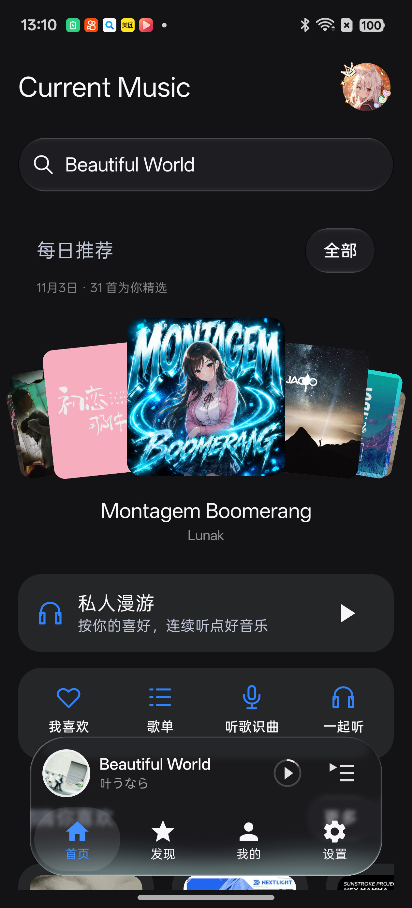
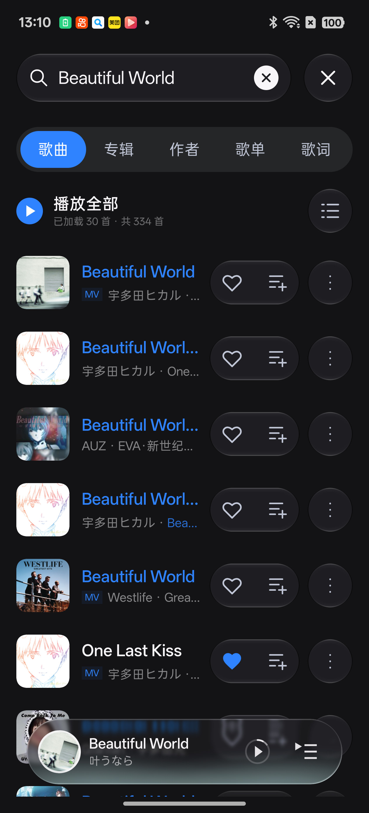
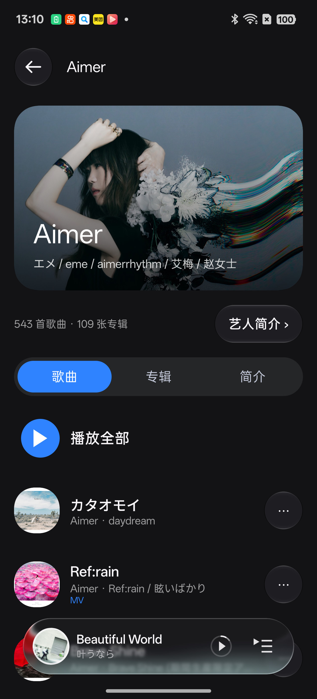
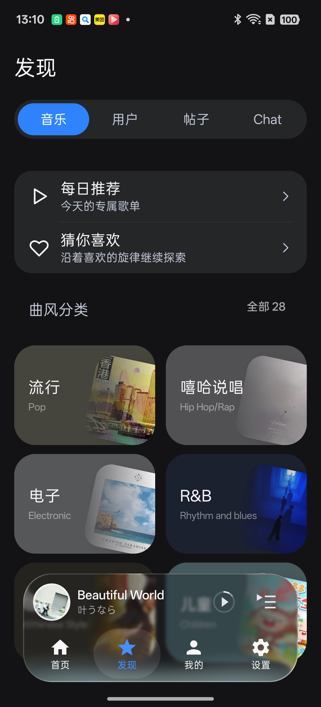

<div align="center">


# CurrentMusicX

**让封面、歌词与音乐一起流动**

网易云音乐库 · Navidrome / Emby 自建曲库 · 双人一起听

Kotlin / Jetpack Compose / Miuix 原生 Android 客户端

<p>
  <a href="https://github.com/bileizhen/CurrentMusicX/releases/latest"></a>
  <a href="#兼容性"></a>
  <a href="#开源与致谢"></a>
</p>

**[下载应用](https://github.com/bileizhen/CurrentMusicX/releases/latest)** · [开始使用](#开始使用) · [更新记录](https://github.com/bileizhen/CurrentMusicX/releases) · [反馈问题](https://github.com/bileizhen/CurrentMusicX/issues)

</div>

CurrentMusicX 是 [CurrentMusic](https://github.com/backrooms-yrc/CurrentMusic) 的原生 Android 客户端。圆形封面、动态取色、逐字歌词与悬浮播放器，让音乐库、发现和播放自然衔接，适配竖屏、横屏与宽屏布局。

## 界面预览

<p align="center">
  
  
</p>

<p align="center"><sub>RMX5060 真机 · 正式版 1.3.1 · 2026-11-03 拍摄。界面以实际安装版本为准；点击图片可查看原图。</sub></p>

<details>
<summary>更多界面：歌词、搜索、艺人主页与发现</summary>

<p align="center">
  
  
</p>
<p align="center">
  
  
</p>

</details>

## 开始使用

1. **下载安装。** 前往 [Releases](https://github.com/bileizhen/CurrentMusicX/releases/latest) 下载 `CurrentMusic-Android-v版本号.apk`，按系统提示安装。同签名正式版可覆盖升级。
2. **选择来源。** 在「设置 → 音源与网络」分别选择音乐音源和歌词来源。歌词默认**自动择优：逐字优先，逐行兜底**。
3. **连接音乐库。** 按需登录 CurrentMusic、绑定网易云，或在「设置 → 音源与网络 → 自建曲库」连接 Navidrome / Emby，即可搜索、收藏和播放。连接后的曲库入口会显示在「我的 → 音乐服务」，退出账号后隐藏。

歌曲、音质、会员音效及推荐的可用性，以对应服务和账号权限为准。本页介绍当前 `main` 源码；已发布版本的变化与验收范围见 [GitHub Releases](https://github.com/bileizhen/CurrentMusicX/releases)。

[功能一览](#功能一览) · [音源与歌词](#音源与歌词) · [兼容性](#兼容性) · [常见问题](#常见问题) · [构建与测试](#从源码构建与设备测试) · [参与贡献](#issuespr-与版本发布)

## 功能一览

### 随音乐展开的播放体验

- **播放与控制**：后台、通知栏、锁屏和蓝牙控制；队列、循环、随机、心动模式、定时关闭、DLNA 投屏及 MV。
- **歌词与动效**：六源自动匹配，逐字高亮、翻译与罗马音；莫奈动画、流烟、星尘与透视效果；单曲偏移、多格式导入及 FIA / LRC 导出。
- **音效与衔接**：本机均衡器、原版标准及智能音效、AI 情绪调音师、AI 调音大师与外放场景；智能过渡或淡入淡出。
- **下载与分享**：音质与目录选择、后台进度、取消与重试；写入音频标签、封面和歌词；生成海报、播放链接与二维码。
- **音质档位**：Hi-Res（`hires`）、高清臻音（`jyeffect`）和臻音全景声（`vivid`）分别显示；可选较高及杜比全景声。所选档位是向音源请求的质量，不代表最终文件或设备输出已达到该质量，实际可用性取决于音源、歌曲与账号权限。

### 自己的音乐库，也能一起听

- **音乐库**：网易云我喜欢与歌单管理、CurrentMusic 自建歌单、Navidrome / Emby 专辑与艺术家；支持收藏、搜索和原音质播放。
- **本地音乐**：进入「本地音乐 → 扫描范围 → 选择文件夹」，只扫描所选目录及子目录，记住所选位置；授权失效时提示重新选择。扫描全机音乐需要显式选择并授予音频权限，修改扫描范围不替换当前播放队列。
- **发现音乐**：分类搜索、歌词搜歌、候选词、每日推荐、热搜与音乐风格；私人漫游支持默认、熟悉、探索、拼图及动态场景，结束后可恢复原队列。
- **双人一起听**：网易云原生邀请与短链接、共享队列、同步切歌与断线恢复；一起听记录、排行、结束报告和缘分报告。
- **账号与交流**：多账号、资料管理、密码修改与邮箱找回、听歌统计、公告、帖子、公共聊天和 AI 对话；可选网易云任务中心与前台自动签到，默认关闭。

### 调成喜欢的样子

深浅主题、纯黑模式与 Monet 取色；圆形或沉浸式封面、自定义播放背景、液态玻璃、悬浮底栏与桌面歌词。外观页可实时预览主题，调整颜色、字体、文字缩放、开屏动画和歌单样式。

<details>
<summary>外观与交互细节</summary>

- **主题与字体**：预览首页、发现、我的、设置和迷你播放器；支持色板、网格 / 光谱 / HSV 取色、系统字体搜索及导入 TTF / OTF / TTC，导入字体复制到应用内保存。
- **玻璃材质**：「设置 → 外观 → 液态玻璃」可选标准或液态；液态样式参考 FlClash 的透光、折射边缘与柔和阴影，模糊开关独立控制磨砂程度。Android 13 以下或无法采样背景时使用普通面板。
- **开屏动画**：经典（默认）、光环、签名与无动画，可在设置中预览。签名样式离线书写当前用户名，空用户名显示「欢迎聆听」；长名字自动换行缩放，未覆盖字形渐显，系统关闭动画时直接进入完成态。
- **导航与布局**：固定渐隐顶栏、悬浮底栏、分组圆角设置列表与容器变换返回；Chat 使用多行输入区和添加菜单，保留失败草稿与显式重试，进入后隐藏底栏。
- **横屏播放器**：遵循外观页的封面选择；沉浸式封面铺满播放页，右侧歌词与控制区使用渐暗背景，左右滑动仍在歌词和播放控制之间切换。
- **歌单浏览**：Depth Ribbon 立体缎带或 CD 唱片架；唱片架支持随机挑歌、高潮片段或整首试听、循环及自动下一首，取消喜欢后可撤销。

</details>

<details>
<summary>播放、歌词与音效说明</summary>

- 搜索结果点击单曲只插入并播放该曲，保留原队列；歌单和专辑支持整列表播放。
- 自动切歌的智能过渡与淡入淡出择一开启，默认关闭；淡入淡出可调 1–12 秒。允许与其他应用同时播放可单独设置。
- 「播放器右上角菜单 → 播放背景」可从系统选择图片，预览并调整 0–100% 模糊度；图片仅保存在本机，重启保留，可恢复默认封面取色背景。
- 「我的 → 网易云账号 → 网易云任务」开启后，“我的”页会在网易云账号下方显示任务入口。需要本机网易云登录；自动签到另行开启，仅在 App 前台进行日常与云贝签到。任务进度和奖励由网易云确认，听歌使用实际播放记录。
- 歌词优先使用真实逐字时间，过滤服务端估算轴。卡拉 OK 兼容策略选「总是」时，可为普通逐行歌词生成近似高亮，属于本地显示效果。
- 音效页面使用原生 Compose；已内置适配的 ARM64 引擎，无需另装网易云。会员权益由服务端核验，未接入的算法会明确提示；外放场景仅在当前运行期间保留。
- 应用内不常驻显示歌词 / FPS 灵动岛，仅临时显示音效、下载与错误反馈；桌面悬浮歌词需系统授权，支持位置、字号、翻译和锁定。

</details>

<details>
<summary>音乐库、搜索与一起听说明</summary>

- 网易云登录需先注册并登录 CurrentMusic 账号，再使用扫码或手机验证码。本机登录后仍直连网易云搜索、歌单、收藏、推荐与评论。没有本机登录时，部分服务可复用 CurrentMusic 账号的云端绑定，云端凭据不下载到本机。
- 「网易云作为主音乐库」决定默认音乐库入口；「设置 → 播放 → 默认红心位置」独立控制收藏目标。Navidrome 歌曲使用自己的服务器收藏。
- 歌单支持搜索、排序、创建与管理，可选 Depth Ribbon 立体缎带或 CD 唱片架浏览；唱片架支持搜索收拢、随机挑歌、高潮片段或整首试听、循环与自动下一首，取消喜欢后可在灵动岛撤销。CurrentMusic 自建歌单可导入网易云「我喜欢」。切换音乐库不会删除原有歌单。
- 搜索首页支持收起历史、双列推荐词和可横滑的网易云搜索热榜（含 ACG、日语等分类）；输入片段显示候选词，点选直接搜索；「歌词」分类支持输入记得的歌词搜歌，并展示命中的歌词片段。
- 搜索页「歌单」分类展示网易云歌单封面、创建者和歌曲数，支持分页与失败重试；点击沿用原有歌单详情，切换分类及返回后保留结果与滚动位置。
- 网易云一起听复用原有搜索与播放队列，支持双方口味推荐、移除、清空、整队列下载和收藏；推荐、历史、排行与报告受服务端权限限制。
- 冷启动检查并恢复中断的网易云会话；启动时主动开始其他播放会取消本次自动恢复。结束会话后，确认远端结束才展示报告，可收藏歌曲并导出分享海报。
- CurrentMusic 服务器房间另支持密码、点歌审批和成员权限。Navidrome / Emby 私有曲库当前仅在本机播放，不参与 CurrentMusic 房间或 DLNA 投屏。

</details>

## 音源与歌词

音乐音源与歌词来源**独立设置**，在「设置 → 音源与网络」调整。切换歌词来源会重新加载当前歌词，缓存按来源隔离。

### 音乐从哪里来

| 音源 | 使用方式 |
| --- | --- |
| **CurrentMusic（默认）** | 通过配置的 CurrentMusic 服务器取流，需站内账号 |
| 网易云原生 | 手机直连，使用本机网易云账号权限；不自动回退到服务器取流 |
| LeiZ API | 配置 API Key 后使用对应服务，密钥加密保存在本机 |
| 落雪音源 | 从 `.js` 文件或链接导入脚本；目前仅解析带有效网易云 ID 的歌曲，搜索与歌单保持原有来源 |

落雪脚本会向其服务方发送歌曲信息，请仅导入可信来源。Navidrome 在「设置 → 音源与网络 → 自建曲库」连接，音频直接从自己的服务器播放。

Emby 可从「设置 → 音源与网络 → 自建曲库 → Emby」连接，连接后在「我的 → 音乐服务」显示「Emby 曲库」。默认进入歌曲，底栏使用与主页相同的交互，切换歌曲、艺术家、歌单和我喜欢；专辑从艺术家页面进入。顶部搜索与刷新合为一组图标，搜索沿用歌单页的展开方式。填写服务器地址（支持反向代理子路径）、用户名与密码；登录后仅加密保存令牌，不保存密码。专辑、歌曲、艺术家、歌单及我喜欢均按 40 条分页读取，支持歌曲搜索、服务器收藏、队列播放、原音质缓存和预加载。歌单当前只读，下载遵循服务器账号权限；不提供转码、一起听、投屏或服务器播放记录上报。歌词沿用应用的自动匹配、手动匹配及本地导入，暂不读取 Emby 服务端歌词。


### 歌词如何选择

- **自动择优（默认）**：按 QQ → 网易云 → AMLL → 酷狗 → 汽水 → CurrentMusic 顺序查找；歌曲信息匹配 ≥75% 时参与选择，遇到真实逐字即采用，否则保留首份可用逐行歌词。
- **指定来源**：可选 CurrentMusic（含服务端 LDDC 数据）、手机直连网易云 YRC / LRC，或本地内嵌歌词。
- **指定单曲**：在播放页「歌词管理」中搜索、预览、保存或导入；手动保存与导入的单曲歌词、本地内嵌歌词优先于自动选择。

**希望歌曲和歌词都直连网易云？同时选择「网易云原生」音源和「网易云歌词」。** 本机网易云音乐库与原生双人一起听也独立直连网易云。

<details>
<summary>歌词匹配、偏移与导入导出</summary>

- 支持导入 LRC、TTML、FIA、VTT、YRC、明文 QRC 和 KRC。
- 沿用 Folia 歌曲信息评分：歌名 45、歌手 25、专辑 30，再按时长差折扣；每个来源从前十个结果中取最匹配的可靠候选，自动门槛为 75 分。不以歌词正文或时间轴相似度自动选择。
- AMLL 使用匹配到的网易云歌曲 ID 查询，不要求网易云基准歌词可用；慢来源超时跳过，手动预览保留自适应对齐。
- 原始逐字时间保留；显示层校正由播放页、迷你播放器与桌面歌词共用。单曲偏移正值延后、负值提前，可在已有对齐后叠加或独立归零。
- FIA / LRC 导出保留原时间轴，不将估算高亮写成真实逐字数据；FIA 另行保存并恢复自适应对齐信息。

</details>

<details>
<summary>CurrentMusic 服务器与更新下载线路</summary>

「设置 → 音源与网络 → CurrentMusic 服务器」提供固定顺序的自动、`music.20110208.xyz` 主站、`cm.bileizhen.top` CDN、`currentmusic.geekertao.com` CDN、`music.ctcehs.com` CDN 和自定义选项，并显示公告接口的响应延迟，不按延迟排序。新安装默认自动，启动时测速选择较快的可用预设线路，也可手动重新检测；已有服务器配置保留原选择。主站和 CDN 切换保留登录，自定义地址独立保存，切换到其他服务器需重新登录。完整接口路径为 `/cm/`。更新下载中的 CurrentMusic 专用源同步跟随自动或手动选择的内置 CDN，探测与后台下载使用同一路由，安装包继续按 GitHub 发布信息校验大小和 SHA-256。

此地址用于站内账号、CurrentMusic 音源与歌词、云端绑定、个人资料、社区及服务器房间。网易云原生、LeiZ API、外部音频及歌词来源继续使用各自的地址；Navidrome 音频直接从自己的服务器播放。

</details>

## 兼容性

| 项目 | 要求 |
| --- | --- |
| 系统 | Android 8.0 / API 26 及以上；目标 Android 16 / API 36 |
| 架构 | 正式安装包面向 ARM64（arm64-v8a），包含适配的原版音效引擎 |
| 布局 | 竖屏、横屏与宽屏导航 |
| 动态颜色 | Monet 需要 Android 12 / API 31 及以上 |
| 实时模糊 | Android 13 / API 33 及以上；低版本或关闭时使用普通材质 |
| 下载目录 | 系统文件夹选择器 / SAF；Android 10 及以上默认 `Download/CurrentMusic` |

部分供应商原生库仍不满足 16 KiB 页要求，不能视为已完成该类设备兼容验证。

## 常见问题

<details>
<summary>下载的歌曲、封面和歌词保存在哪里？</summary>

下载时可指定目录，并授予该目录访问权限。歌曲信息、封面与歌词写入音频文件，同时保存配套 LRC 和封面。支持 MP3、FLAC、M4A、Vorbis OGG、WAV，裸 AAC 无损封装为 M4A。其他播放器的内嵌歌词与逐字显示能力取决于格式及其自身支持。

</details>

<details>
<summary>如何更新？自行构建的包能覆盖官方版吗？</summary>

在「设置 → 检查更新」查看新版本，可调整启动检查、更新渠道和下载来源。启动发现新版本时可先忽略或查看详情；来源列表显示状态与延迟，专用镜像置顶，其余可用来源按延迟排序。后台下载支持取消、重试和换源；默认镜像失败或文件大小、SHA-256 不符时尝试备用源。校验包名与签名后，由 Android 系统确认安装；首次可能需要允许安装未知来源应用。

自行构建的包若与官方签名不同，无法直接覆盖。开发与设备测试请使用[独立测试包](#从源码构建与设备测试)，与日常安装分开。

</details>

<details>
<summary>如何反馈问题？</summary>

请在 [Issues](https://github.com/bileizhen/CurrentMusicX/issues) 提供应用版本、手机型号、Android 版本、复现步骤与现象。可从设置中导出诊断日志，分享前检查并遮挡个人信息。

</details>

## 隐私与开发

本机账号凭据加密保存，服务分别请求网易云、CurrentMusic、Navidrome 或 Emby 接口；音频、MV 与图片从对应服务返回的地址加载，下载文件保存在用户选择的目录。数据用途及保存方式见[隐私说明](PRIVACY.md)。

欢迎提交 Issue 或 Pull Request。请说明解决的问题与实际验证结果，按独立功能或修复拆分提交。

## 从源码构建与设备测试

准备 JDK 17 及以上、Android SDK Platform 37.0 和 Build Tools 35.0.0。通过 `ANDROID_HOME` 或本机 `local.properties` 的 `sdk.dir` 指定 SDK 路径。

Windows / PowerShell：

```powershell
.\gradlew.bat :app:assembleDebug :app:testDebugUnitTest :app:lintDebug
```

Linux / macOS 使用 `./gradlew` 执行相同任务。Debug APK 位于 `app/build/outputs/apk/debug/app-debug.apk`。

连接设备后，可使用独立测试包，与日常安装的数据隔离：

```powershell
.\gradlew.bat -PisolatedDebug=true :app:assembleDebug :app:connectedDebugAndroidTest
```

独立 Debug 包名为 `com.bileizhen.currentmusic.verification`。设备测试可能需要登录、网络、系统权限或指定素材；构建和单元测试通过不代表实际接口与界面已经验证。

正式包使用 `:app:assembleRelease` 构建。签名从本机未入库的 `keystore.properties` 读取 `storeFile`、`storePassword`、`keyAlias` 和 `keyPassword`；未配置时生成未签名包。密钥、账号配置与验证产物不入库。

<details>
<summary>Release 体积、Baseline Profile 与性能回归</summary>

Release 启用 R8 与资源压缩，仍发布一个包含现有 ABI 的通用 APK；保留网易云原版音效、MNN 和对应 JNI 名称。可复现体积报告：`python scripts/apk_size_report.py app/build/outputs/apk/release/app-release.apk --json output/apk-size.json`。报告区分 ZIP 压缩大小、各 ABI 解压占用与 ELF 页对齐，不将体积变化当作运行速度改善。部分既有供应商原生库仍不满足 16 KiB 页要求。

性能测试使用独立的 `com.bileizhen.currentmusic.benchmark` 应用，不访问用户账号或在线服务。`baselineprofile` 与 `benchmark` 模块覆盖冷启动、首页、播放器、播放、歌词、歌单、设置和输出模式；执行 `:app:generateBaselineProfile` 显式采集，再用 `:benchmark:connectedPerformanceAndroidTest` 比较 `compilation=none` 与 `compilation=baseline`。未实际生成 Profile 时，后者应失败，不把框架或依赖自带 Profile 视为本项目已完成采集。设备需支持 AndroidX Macrobenchmark（测试模块最低 Android 9，不改变正式应用 Android 8 的最低版本）。

压缩运行时回归可用 `:benchmark:connectedPerformanceAndroidTest -Pandroid.testInstrumentationRunnerArguments.class=io.github.currencortex.music.benchmark.MinifiedRuntimeSmokeTest` 单独执行，验证脚本、序列化、Room、JNI 加载和本地音频标签读写；它不证明真实 USB DAC、蓝牙或最终硬件 Bit-perfect。测试 APK 的静音前台服务仅用于防止厂商冻结测试进程，不进入正式 APK。性能数据、录屏与诊断日志保存在本机，不入库。

</details>

## Issues、PR 与版本发布

使用 [Issue 表单](https://github.com/bileizhen/CurrentMusicX/issues/new/choose)报告问题或提出建议；PR 按[仓库模板](.github/PULL_REQUEST_TEMPLATE.md)说明变化与验证。完整解决问题时用 `Fixes #编号`，仅关联讨论时用 `Refs #编号`。

开发流程：**独立功能分支 → PR → CI → 合并 `main`**。一个 PR 对应一个明确改动，功能分支使用 `bileizhen/` 前缀、推送到 `releases`，目标为 `bileizhen/CurrentMusicX:main`。保留原子提交，版本号等发布准备另开最后一个 PR。

<details>
<summary>Issue 分流、过期处理与 PR 检查</summary>

- Issues 提供「报告问题」「功能建议」表单。Bug 请填写版本、设备与 Android 版本、复现步骤和预期结果；日志、截图必须脱敏。新建 Issue 不代表问题已经确认或承诺实现。
- 自动分流根据表单选择设置 `module: *` 标签，缺少必要信息时使用 `needs-info` 并更新同一条追问评论。自由格式问题保留人工判断，不使用 AI 猜测重复问题或自动关闭。仓库变量 `TRIAGE_MODE` 支持 `live`（默认）、`dry-run`、`off`。
- 每天北京时间 03:00 检查过期条目。`STALE_MODE` 默认 `dry-run`，维护者检查 Actions 日志后可设为 `live`：缺信息 14 天、无活动 60 天标记 stale，再等待 30 天；每次最多关闭两个符合条件的 Bug／问题。功能建议、PR、已分配负责人、有里程碑、重开过的条目受保护；`bot: skip`、`needs follow-up` 等标签可豁免。关闭理由是暂不计划处理，不代表修复完成。作者回复会转为待跟进，普通讨论会解除 stale。
- 开发使用独立功能分支 → PR → CI → 合并 `main`。PR 标题使用 `feat:`、`fix:`、`perf:`、`docs:`、`deps:` 或 `chore:` 等前缀，机器人映射到已有发布分类标签；维护者手工添加的标签不被自动撤销。一个 PR 对应一个明确改动，完整解决问题时用 `Fixes #编号`，仅关联讨论时用 `Refs #编号`，不为制造发布条目而创建空 PR。
- PR 元数据自动化只运行默认分支的可信脚本，不检出或执行 fork 的 PR 代码。Android CI 在 PR 中执行 Debug 构建、单元测试、Lint 和测试包编译；主线或手动运行直接生成 CI Release 包并执行 Release 单元测试和 Lint，不再先构建 Debug 再重复构建 Release；协作脚本由 `node --test .github/scripts/*.test.cjs` 测试，工作流由 actionlint 校验。代码检查通过不等于已完成真机验收。
- 仅修改根目录 README 系列文档、`.github/img/` 展示图片，或 Android CI / Collaboration checks / CI 分发工作流及 `android-ci-scope` / `ci-release` 脚本与测试时，`build` 只检查改动范围，不安装 Android 工具链、不编译或上传 APK；协作检查仍执行脚本测试和 actionlint 工作流校验。源码、运行时素材、Gradle 配置、发布流程或其他文件有变化时执行完整 Android 检查；无法确认完整差异时也执行完整检查。手动运行 Android CI 始终执行完整检查；同一分支的新提交或手动运行会取消仍在执行的旧构建。
- 仓库允许对已审查的具体 PR 启用 Auto-merge，仅使用 Merge commit 保留原子提交。`main` 要求分支与主线同步、解决审查讨论，并通过 Android CI 的 `build` 和 Collaboration checks 的 `test`，管理员同样受约束；独立维护者不强制第二人批准。前一个 PR 合并后，后续 PR 若落后于主线，需更新分支并重新检查。
- PR 合并后由 GitHub 自动删除远端功能分支，PR 记录和提交历史保留。本地分支及 worktree 不自动删除，清理前确认没有未提交或未合并的工作。
- `Update PR branches` 在主线推进、PR 打开或更新时自动把 `main` 合入落后的非草稿 PR。仅处理无冲突且允许维护者更新的分支，使用精确 head SHA 防止并发覆盖；已同步的分支不重复更新，`bot: skip` 可退出自动处理。工作流只运行主线可信脚本，不检出 PR 代码、不强推、不代替审查或自动批准 CI。使用内置 `GITHUB_TOKEN` 更新后，GitHub 可能要求维护者批准新检查；fork 权限不足、冲突或分支保护阻止更新时会在日志提示，需人工处理。
- 更新设置提供「正式版 / CI 版」。旧「预发布版」选择自动迁移为 CI；CI 只接收 `vX.Y.Z-ci.N` 的完整签名构建，不接收普通 beta/rc 或 PR Debug 产物。CI 渠道隐藏只返回正式包的 CurrentMusic 专用源，保留 GitHub 和其他代理源，并沿用 SHA-256、大小、包名、版本及签名校验。
- `Publish CI build` 只下载 **main 的 Android CI 实际构建、验证并上传**的 `ci-unsigned` 产物，严格绑定上游运行 ID，不再次调用 Gradle 或编译 APK。通过 `ci-signing` GitHub Environment 中的 `SIGNING_KEYSTORE_BASE64`、`SIGNING_STORE_PASSWORD`、`SIGNING_KEY_ALIAS`、`SIGNING_KEY_PASSWORD` 使用现有正式签名。该 Environment 限制 main；签名 job 不向 PR 开放，密钥不入库、不作为产物上传。纯文档或轻量 CI 调整跳过安装包分发；缺少签名则失败，不发布未签名包。
- CI 通过公开的 GitHub prerelease 附件分发，无需用户提供 Token。版本为 `X.Y.Z-ci.N`，N 来自主线 Android CI 的运行编号；每次使用独立 tag，不覆盖已有附件，不修改最新正式 Release。分发时若主线已前进则跳过过时构建。自动说明标注检查范围，不代替真机验收。
- Android 安装版本码使用 `基础 versionCode × 100000 + N`，正式版的 N 为 0；后续正式发布必须递增基础 versionCode 和版本号，使它高于上一版本所有 CI。CI 可保留数据覆盖原正式版，但切回正式版须等待后续更高版本，不通过卸载或绕过系统降级检查处理。单个 CI 编号范围 1–99999，超出时构建失败并由维护者迁移编号规则。

</details>

<details>
<summary>版本草稿、签名附件与发布说明</summary>

- 版本号单独提交并通过 PR 合并后，为验证过的主线提交打 `vX.Y.Z` tag。运行 **Prepare release draft**，填写本次 tag、上次正式版 tag 和中文摘要。流程验证版本号、提交祖先关系、已有 Release 和 main 的 Android CI，再使用 GitHub 原生 API 按 `.github/release.yml` 生成分类清单，保留 `by @作者 in #PR`、新贡献者与 `Full Changelog` 链接；Release 构建、单元测试和 Lint 通过后创建草稿。
- 发布仍使用一个通用 APK，不按 ABI 分包。正式版草稿工作流仅验证 Release 构建，不发布未签名 APK；维护者上传同一提交的正式签名 APK 和 SHA-256 文件、补齐真实设备验收与下载验证后再发布正式版。CI 签名使用上述受保护 Environment，密钥不进入源码或构建产物。已有 Release 不会被覆盖，不自动发布正式版。
- 发布头图上传为对应 Release 的附件，并在 Release notes 顶部嵌入，不提交到源码仓库。迁移旧头图时先核对附件完整性、更新发布说明中的图片链接，再移除仓库文件；应用图标和 README 功能截图不受影响。
- 历史直接提交而无关联 PR 的变化如实补充到中文摘要，不伪造作者与 PR 编号。完整更新说明仅维护在 GitHub Releases，不新增本地 CHANGELOG。

</details>

## 开源与致谢

既有代码按 [GPL-3.0-only](LICENSE) 分发；Folia 莫奈歌词动画与播放暂停渐变移植组件按 [AGPL-3.0-only](app/src/main/assets/legal/AGPL-3.0.txt) 分发，组合遵循两份许可证第 13 节。各上游组件保留自己的版权与许可，完整说明见[第三方声明](THIRD_PARTY_NOTICES.md)。

感谢 [CurrentMusic](https://github.com/backrooms-yrc/CurrentMusic)、[Folia](https://github.com/chthollyphile/folia-major)、[Miuix](https://github.com/compose-miuix-ui/miuix)、[SukiSU-Ultra](https://github.com/SukiSU-Ultra/SukiSU-Ultra)、[AndroidLiquidGlass](https://github.com/Kyant0/AndroidLiquidGlass)、[LeiFetch](https://github.com/bileizhen/LeiFetch)、[123PanX](https://github.com/bileizhen/123PanX)、[XBlocker](https://github.com/bileizhen/XBlocker)、[AMLL TTML DB](https://github.com/amll-dev/amll-ttml-db)、[LXGW WenKai](https://github.com/lxgw/LxgwWenKai)，以及 AndroidX、Media3、Coil、Jaudiotagger、ZXing 等开源项目。

<details>
<summary>浏览量</summary>

<div align="center">


</div>

</details>
